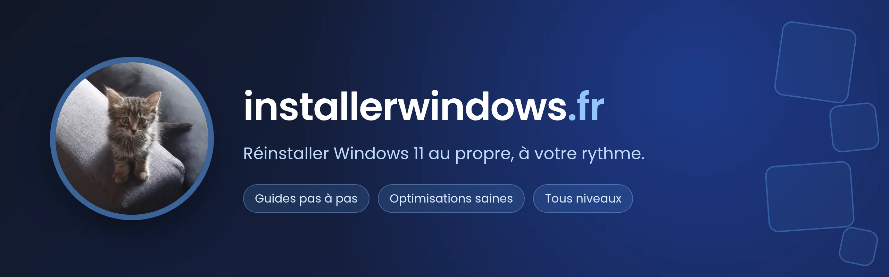

# Installerwindows.fr

Guides pour (ré)installer Windows 11 au propre et faire des optimisations saines pour votre machine. Il s'agit de guides complets, que vous devriez pouvoir suivre quel que soit votre niveau en informatique.

Site : <https://installerwindows.fr/>

## Où vit le contenu des guides

Les guides sont des fichiers Markdown hébergés sur GitHub. Un administrateur ajoute un guide à partir de son URL GitHub ; le site le récupère et l'affiche. Les guides en production viennent des dépôts de Piwielle, dont la liste de développement est dans `database/seeders/guide_seeder.ts`.

Pour corriger le contenu d'un guide, modifiez le dépôt source du guide, pas celui-ci.

## Prérequis

- [mise](https://mise.jdx.dev/) : `mise.toml` fixe les versions de Node et pnpm.
- Docker, pour la base PostgreSQL.

## Installation et configuration

```shell
mise install
pnpm install
cp .env.example .env
node ace generate:key
```

`generate:key` remplit `APP_KEY`. Les autres variables sont listées dans [`.env.example`](.env.example). Trois groupes demandent des identifiants :

**Discord (connexion administrateur)**

1. Créez une application sur <https://discord.com/developers/applications>.
2. Dans OAuth2, ajoutez l'URL de redirection `<APP_URL>/auth/callback`.
3. Renseignez `DISCORD_CLIENT_ID` et `DISCORD_CLIENT_SECRET`.

`USERS_IDS` contient les identifiants Discord, séparés par des virgules, des comptes autorisés comme administrateurs.

**Clé d'API YouTube (`YOUTUBE_API_KEY`)**

1. Ouvrez <https://console.cloud.google.com/apis/dashboard>.
2. Recherchez « YouTube Data API v3 » et activez-la.
3. Sur <https://console.cloud.google.com/apis/credentials>, choisissez « Créer des identifiants » puis « Clé API ».

## Lancer

```shell
just dev
```

Démarre PostgreSQL, **efface et recrée la base** (`migration:fresh` puis `db:seed`), puis lance le serveur de développement.

```shell
just prod
```

Construit et démarre les conteneurs de production en local. Les migrations s'exécutent au démarrage du conteneur (`scripts/entrypoint.sh`).

## Vérifier

```shell
just check
```

Lance le lint, la vérification du format, le typecheck et les tests. Les tests lisent `.env.test` : copiez [`.env.test.example`](.env.test.example) et créez la base de test qu'il décrit (`installerwindows_test`, commande en tête du fichier).

## Publier une release

```shell
just release
```

Avant tout, release-it vérifie qu'un commit publiable existe depuis le dernier tag, puis lance `pnpm run check` et `pnpm run build`. Il met à jour `CHANGELOG.md`, crée le commit et le tag, puis ouvre le formulaire de release GitHub. Publier cette release déclenche le déploiement en production : le workflow `.github/workflows/CD.yml` construit l'image Docker, la pousse sur Docker Hub, puis redémarre le conteneur sur le serveur.

## Commandes

Toutes les commandes : `just --list`.

## Licence

MIT, voir [LICENSE](LICENSE).
